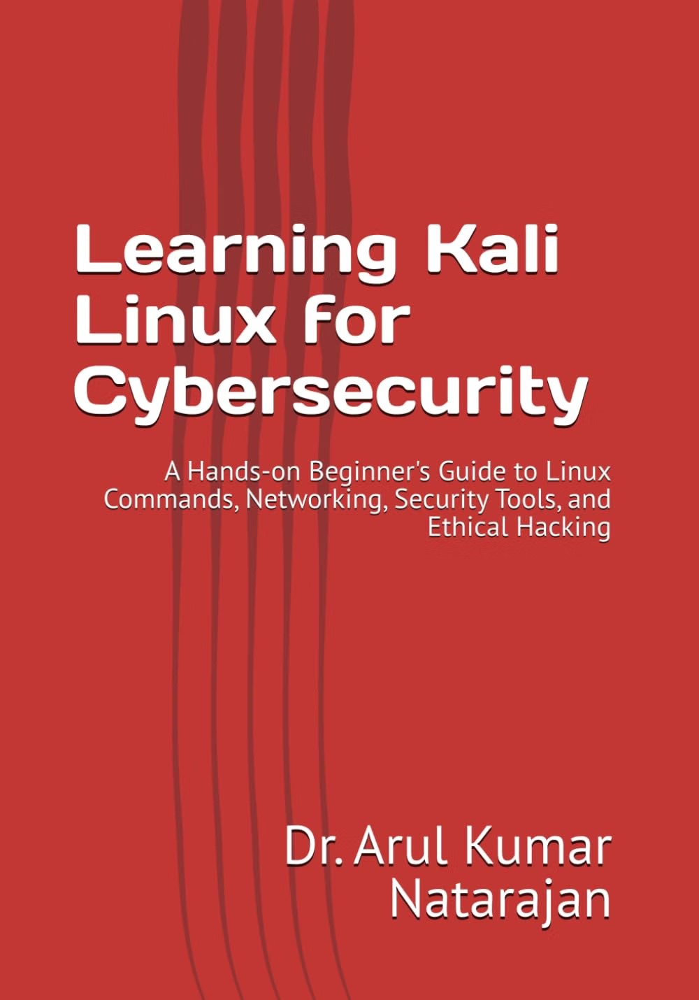

<p align="center">
  
</p>

<h1 align="center">Learning Kali Linux for Cybersecurity</h1>

<p align="center">
  <em>A Hands-on Beginner's Guide to Linux Commands, Networking, Security Tools, and Ethical Hacking</em><br>
  by <strong>Dr. Arul Kumar Natarajan</strong>
</p>

<p align="center">
  <a href="https://www.amazon.com/dp/B0HK25TJMS"></a>
  <a href="sample/Learning_Kali_Linux_for_Cybersecurity_Sample.pdf"></a>
  
  
</p>

This is the official companion repository for the book. It contains the free sample chapter, the complete table of contents, hands-on lab material, command cheat sheets, and an errata list for readers.

> **Book website:** https://itsprofarul.github.io/learning-kali-linux/

---

## About the book

*Learning Kali Linux for Cybersecurity* is a practical introduction to Kali Linux and the fundamental concepts required to begin studying cybersecurity. It is written for readers with limited experience with Linux or security tools who need a clear, structured, hands-on learning path.

The book starts with installing and configuring Kali Linux in Oracle VirtualBox, builds the Linux knowledge required for security work (file system, users and permissions, package management, essential commands, and Bash scripting), introduces core networking concepts, and then moves to practical tools: **Nmap**, **Wireshark**, information gathering, and web enumeration.

Every chapter includes clear explanations, commands, screenshots, examples, review questions, and a hands-on lab.

| | |
|---|---|
| **Author** | Dr. Arul Kumar Natarajan |
| **Edition** | First Edition, 2026 |
| **Published** | September 16, 2026 (independently published) |
| **Length** | 545 pages, 13 chapters, 6 appendices |
| **Formats** | Paperback and Kindle |
| **Paperback ISBN-13** | 979-8194572861 |
| **Buy** | [amazon.com/dp/B0HK25TJMS](https://www.amazon.com/dp/B0HK25TJMS) |

### Who it's for

- Students beginning cybersecurity or Linux courses
- Educators designing introductory cybersecurity labs
- System administrators moving into security
- Aspiring ethical hackers and security professionals

---

## Free sample

📄 **[Download the free sample (PDF)](sample/Learning_Kali_Linux_for_Cybersecurity_Sample.pdf)**

The sample contains the front matter, the complete table of contents, and **Chapter 1: Introduction to Kali Linux** in full.

---

## Table of contents

**Part I: Getting Started with Kali Linux**
1. Introduction to Kali Linux *(free in the sample)*
2. Installing and Configuring Kali Linux
3. Exploring the Kali Linux Desktop

**Part II: Linux Fundamentals**

4. Linux File System and Navigation
5. Users, Groups, and Permissions
6. Package Management and Software Installation
7. Essential Linux Commands
8. Bash Shell and Automation

**Part III: Networking Fundamentals**

9. Linux Networking Essentials
10. Network Scanning with Nmap
11. Packet Analysis with Wireshark

**Part IV: Cybersecurity Tools in Kali Linux**

12. Information Gathering Tools
13. Web Enumeration Tools

**Appendices**
A. Kali Linux Command Cheat Sheet ·
B. Linux Keyboard Shortcuts ·
C. Kali Linux Tool Categories ·
D. Frequently Asked Questions ·
E. Glossary of Linux and Cybersecurity Terms ·
F. Open-Source Cybersecurity Resources

➡️ The section-by-section outline is in [`chapters/`](chapters/README.md).

---

## What's in this repository

```
learning-kali-linux/
├── index.html                  Book website (GitHub Pages)
├── sample/                     Free sample chapter (PDF)
├── chapters/                   Detailed table of contents
├── labs/
│   └── chapter-01/             Chapter 1 hands-on lab + helper script
├── cheatsheets/                Command quick references by chapter
├── ERRATA.md                   Known corrections
└── CITATION.cff                Citation metadata
```

### Getting started with the labs

```bash
git clone https://github.com/itsprofarul/learning-kali-linux.git
cd learning-kali-linux/labs/chapter-01
bash lab01.sh
```

Lab material for further chapters will be added over time. Watch or star the repository to be notified.

---

## ⚠️ Ethical and legal use

> **Perform cybersecurity testing only on systems that you own or systems for which you have explicit authorization to test.**

The material here is for educational, academic, and professional learning purposes. The availability of a system on the Internet or a local network does **not** give permission to scan, monitor, enumerate, or test it. Practice in controlled environments such as local virtual machines, loopback services, dedicated test networks, and intentionally vulnerable training systems (for example, OWASP Juice Shop, DVWA, and Metasploitable 2).

Software changes frequently. Commands, menus, and output on your system may differ from the book; focus on the purpose and workflow of each command and consult current official documentation when needed.

---

## Errata and questions

Found a mistake or something that no longer works with the current Kali release? Please [open an issue](../../issues/new/choose). Confirmed corrections are listed in [ERRATA.md](ERRATA.md).

---

## How to cite

> Natarajan, A. K. (2026). *Learning Kali Linux for Cybersecurity: A Hands-on Beginner's Guide to Linux Commands, Networking, Security Tools, and Ethical Hacking*. Independently published. ISBN 979-8194572861.

<details>
<summary>BibTeX</summary>

```bibtex
@book{natarajan2026kali,
  author    = {Natarajan, Arul Kumar},
  title     = {Learning Kali Linux for Cybersecurity: A Hands-on Beginner's Guide to Linux Commands, Networking, Security Tools, and Ethical Hacking},
  year      = {2026},
  publisher = {Independently published},
  isbn      = {979-8194572861},
  url       = {https://www.amazon.com/dp/B0HK25TJMS}
}
```
</details>

---

## About the author

**Dr. Arul Kumar Natarajan** is Professor and Program Head (Cybersecurity) at the School of Computing, Samarkand International University of Technology (SIUT), Uzbekistan. He has more than 15 years of academic and research experience in cybersecurity, AI for cybersecurity, machine learning for threat detection, network security, and explainable AI.

- 🌐 Website: [itsprofarul.github.io](https://itsprofarul.github.io/)
- 🎓 Google Scholar: [profile](https://scholar.google.com/citations?user=ejaQJu4AAAAJ&hl=en)
- 🆔 ORCID: [0000-0002-9728-477X](https://orcid.org/0000-0002-9728-477X)

---

## License

Copyright © 2026 Dr. Arul Kumar Natarajan. The book text, sample PDF, and cover image are **all rights reserved**. Lab scripts and cheat sheets in this repository may be used for personal study and teaching. See [LICENSE.md](LICENSE.md).
